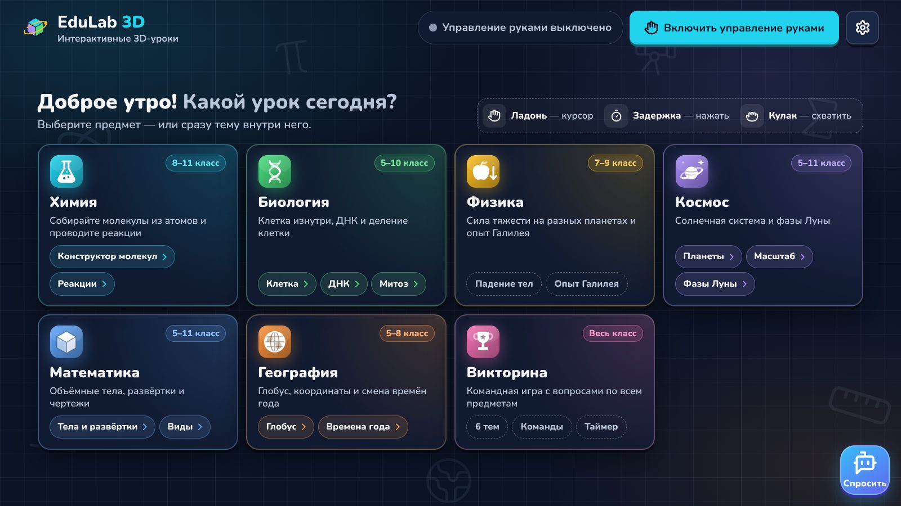
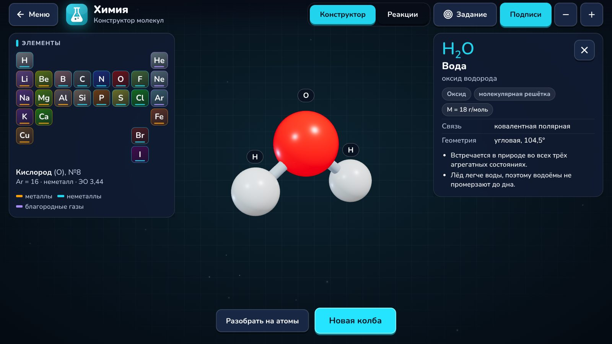
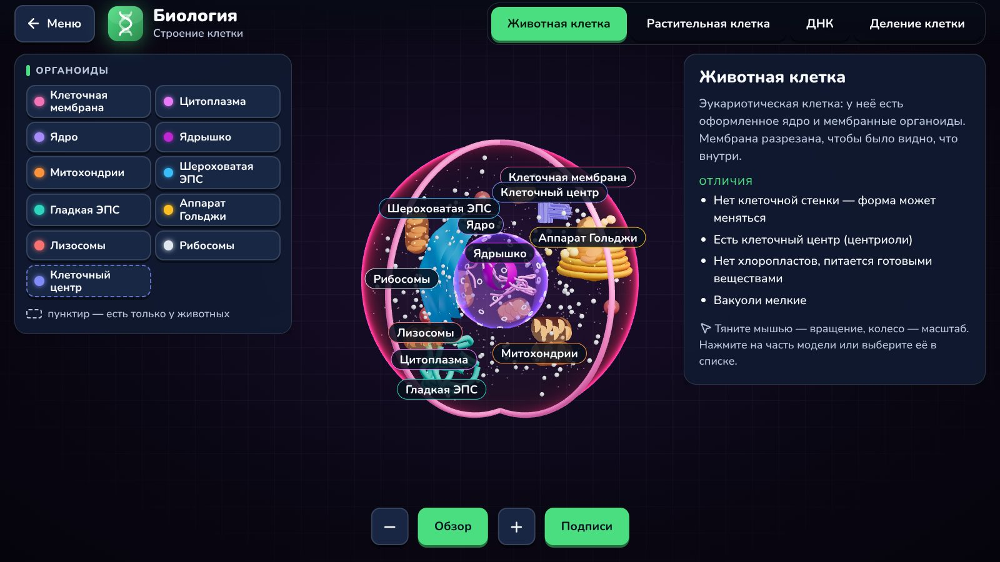
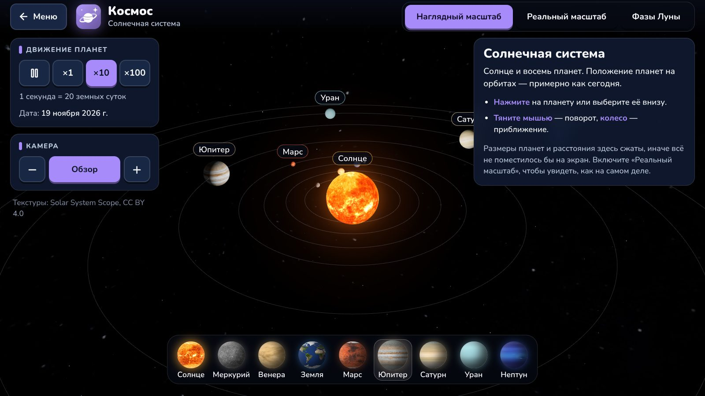
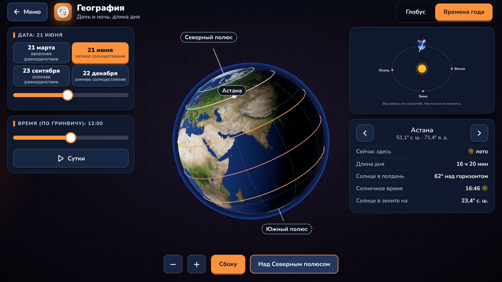

# EduLab 3D

**3D-уроки, которыми учитель управляет жестом руки через обычную веб-камеру.**

Химия, биология, физика, космос, математика, география и викторина в одном приложении.
Учитель стоит у доски и управляет экраном ладонью (мышь тоже работает), класс смотрит на проектор.
Интерфейс на русском, приложение работает **без интернета**: шрифты, текстуры и модели лежат в проекте,
распознавание руки идёт прямо в браузере.



| | |
| --- | --- |
|  |  |
|  |  |

## Зачем

- Современные кабинеты физики, химии и биологии есть не в каждой школе.
- Молекулы, клетку, орбиты и смену времён года трудно объяснить на плоской доске.
- Интерактив обычно привязывает учителя к компьютеру и мыши.

EduLab 3D нужен только ноутбук с веб-камерой и проектор, которые уже есть в классе.

## Лаборатории

| Лаборатория | Что внутри |
| --- | --- |
| Химия | Конструктор молекул: 60 веществ с реальными углами связей, кратные связи, ионные решётки, молярная масса, подсказки. «Задание»: собрать вещество по названию. «Реакции»: 10 реакций, ученик уравнивает коэффициенты, затем в 3D рвутся старые связи и собираются продукты. |
| Биология | Животная и растительная клетка с вырезом, 11–13 органоидов; двойная спираль ДНК с репликацией; митоз по фазам. |
| Физика | Комната с предметами: захват и бросок рукой, гравитация Земли, Луны, Марса, Юпитера, невесомость, сопротивление воздуха, опыт Галилея. |
| Космос | Солнечная система с текстурами планет, наглядный и реальный масштаб, карточки планет; фазы Луны. |
| Математика | 11 тел с формулами объёма и площади и развёртками; «Виды (чертёж)»: собрать фигуру из кубиков по трём видам. |
| География | Глобус с координатами, главными линиями и 14 городами; игра «Найди точку»; день и ночь, длина дня и высота Солнца на любую дату. |
| Викторина | 6 тем, команды, таймер; ответы рукой. |
| EduBot | AI-помощник: объясняет тему текущей лаборатории, отвечает голосом. |

Каждую тему можно открыть сразу по ссылке: `#chemistry/react`, `#biology/mitosis`, `#cosmos/moon`, `#geo/seasons`.

## Управление рукой

- Ладонь в кадре — на экране появляется курсор.
- **Задержать курсор** на кнопке (~1 с) или **сжать кулак / щепоть** на ней — нажатие.
- Сжать кулак в пустом месте и двигать рукой — вращение модели.
- Ползунки перетаскиваются схваченной рукой.

## Запуск для демо

```bash
npm install
npm run build
npm run preview    # открыть http://localhost:4173 в Chrome, нажать «Включить управление руками»
```

Для разработки: `npm run dev`. Для EduBot скопируйте `.env.example` в `.env` и укажите ключ
(ключ остаётся на сервере разработки, в браузер не попадает).

## Проверки

```bash
npm run check      # всё сразу
npm run lint       # проверка кода
npm run check:chem # все вещества можно собрать, все реакции уравнены
npm run check:math # формулы тел сверены с сеткой, развёртки не пересекаются
npm run check:geo  # координаты, расстояния, длина дня, день и ночь на глобусе
```

## Структура

```
src/
  components/ главное меню, чат-бот EduBot
  hand/       отслеживание руки (MediaPipe), курсор, жесты
  ui/         рамка лаборатории, эмблемы предметов, 3D-компоненты
  styles/     дизайн-система (global.css)
  labs/       chemistry, biology, physics, cosmos, math, geo, quiz
scripts/      проверки научной точности
docs/         скриншоты
```

## Автор

**Ескендир Бахитжанов** — основатель и разработчик.

- Финалист Decentrathon 5.0, трек «AI InDrive» (27 марта – 5 апреля 2026)
- Полуфиналист GovTech Camp, трек «Pulse 109», команда IZANTRIA (октябрь 2026)
- Спикер Digital Bridge 2026 с проектом GovTech Camp

Текстуры планет — Solar System Scope, CC BY 4.0.
